<div align="center">



<br><br>

[](https://github.com/ParanoaiDev?tab=followers)
[](https://rovel-labs.fourtopaph.workers.dev/)
[](https://claude.com/claude-code)

</div>

## 👾 Hey, I'm Paranoia

I'm an indie developer who builds software **together with AI**. Claude Code is my everyday pair programmer, and I bring in other agents and local models when a job calls for them.

I like shipping real things fast: apps, Telegram bots, game mods, Windows tools and automation. Most of it runs under **Rovel Labs**, my open-source lab.

```ts
const paranoia = {
  builds: ['apps', 'bots', 'games', 'mods', 'automation', 'dev tools'],
  pairsWith: ['Claude Code', 'Codex', 'local models'],
  believesIn: ['local-first', 'zero telemetry', 'open source', 'obsessive UX'],
  currentlyShipping: 'clawd-buddy',
}
```

## 🚀 Featured projects

<table>
<tr>
<td width="50%" valign="top">

### [🪲 clawd-buddy](https://github.com/ParanoaiDev/clawd-buddy)
A pixel pet for the Claude desktop app. Clawd lives above your prompt box, reacts to what Claude does and speaks 15 languages.

`TypeScript` `SVG` `Claude plugin`

</td>
<td width="50%" valign="top">

### [🌐 NetWard](https://github.com/ParanoaiDev/netward)
An open-source internet resilience and diagnostics companion for Windows, CLI and Android.

`C#` `.NET` `WPF`

</td>
</tr>
<tr>
<td width="50%" valign="top">

### [💸 Skladno](https://github.com/ParanoaiDev/Skladno)
A fast local-first expense splitter with debt minimization, for iOS, Android, macOS and Windows.

`TypeScript` `React` `Capacitor`

</td>
<td width="50%" valign="top">

### [⚡ Portloom](https://github.com/ParanoaiDev/portloom)
A local developer gateway for Windows: ports, hosts profiles, 1-click trusted SSL and a reverse proxy with webhook inspection.

`TypeScript` `Windows`

</td>
</tr>
<tr>
<td width="50%" valign="top">

### [🤫 WhisperBox Bot](https://github.com/ParanoaiDev/whisperbox-bot)
A fully anonymous Telegram feedback bot with two-way replies that never reveal a profile.

`Python` `Aiogram 3` `Docker`

</td>
<td width="50%" valign="top">

### [🎮 Pulse Client](https://github.com/ParanoaiDev/111)
A custom Minecraft 1.20.1 Fabric client with its own launcher, menu, visuals and HUD. No gameplay advantages.

`Java` `Fabric` `Python`

</td>
</tr>
<tr>
<td width="50%" valign="top">

### [🧠 OPERON](https://github.com/ParanoaiDev/agy)
A local-first autonomous operating layer for personal automation and on-device intelligence.

`JavaScript` `Cloudflare`

</td>
<td width="50%" valign="top">

### [🤖 ArtBay Publisher](https://github.com/ParanoaiDev/ArtBay-Publisher-FunPay-bot-)
A fast local bridge between Telegram and FunPay for publishing listings in bulk.

`Go` `Telegram` `Windows`

</td>
</tr>
</table>

## 🛠 Tech I work with

<div align="center">

<a href="https://skillicons.dev"></a>

</div>

## 🤝 My AI crew

<div align="center">


</div>

## 🧭 How I build

- 🛡️ **Privacy first.** No hidden trackers, no ads, no selling data.
- ⚡ **Local-first.** Apps stay fast and keep working offline wherever they can.
- 🔓 **Open source.** Read the code, fork it, improve it.
- 🎨 **Obsessed with UX.** Small details and smooth motion matter.

## 🐍 Contributions

<div align="center">

<picture>
  <source media="(prefers-color-scheme: dark)" srcset="https://raw.githubusercontent.com/ParanoaiDev/ParanoaiDev/output/github-snake-dark.svg">
  <source media="(prefers-color-scheme: light)" srcset="https://raw.githubusercontent.com/ParanoaiDev/ParanoaiDev/output/github-snake.svg">
  
</picture>

</div>
