<div align="center">



<br><br>

[](https://github.com/ParanoaiDev?tab=followers)
[](https://rovel-labs.fourtopaph.workers.dev/)
[](https://claude.com/claude-code)

</div>

## 👾 Hey, I'm Paranoia

I'm an indie developer who builds software **together with AI**. Claude Code is my everyday pair programmer, and I bring in other agents and local models when a job calls for them.

I like shipping real things fast: apps, Telegram bots, game mods, Windows tools and automation. Most of it runs under **Rovel Labs**, my open-source lab.

```ts
const paranoia = {
  builds: ['apps', 'bots', 'games', 'mods', 'automation', 'dev tools'],
  pairsWith: ['Claude Code', 'Codex', 'local models'],
  believesIn: ['local-first', 'zero telemetry', 'open source', 'obsessive UX'],
  currentlyShipping: 'clawd-buddy',
}
```

## 🚀 Featured projects

<table>
<tr>
<td width="50%" valign="top">

### [🪲 clawd-buddy](https://github.com/ParanoaiDev/clawd-buddy)
A pixel pet for the Claude desktop app. Clawd lives above your prompt box, reacts to what Claude does and speaks 15 languages.

`TypeScript` `SVG` `Claude plugin`

<a href="https://github.com/ParanoaiDev/clawd-buddy"></a>

</td>
<td width="50%" valign="top">

### [🌸 Flora for Obsidian](https://github.com/ParanoaiDev/obsidian-flora)
A new look for all of Obsidian and a graph of your notes that feels alive: glass UI, living neurons in 2D and 3D, a spider that finds missing links and live wallpapers.

`JavaScript` `WebGL2` `Obsidian plugin`

<a href="https://github.com/ParanoaiDev/obsidian-flora"></a>

</td>
</tr>
</table>

## 🛠 Tech I work with

<div align="center">

<a href="https://skillicons.dev"></a>

</div>

## 🤝 My AI crew

<div align="center">


</div>

## 🧭 How I build

- 🛡️ **Privacy first.** No hidden trackers, no ads, no selling data.
- ⚡ **Local-first.** Apps stay fast and keep working offline wherever they can.
- 🔓 **Open source.** Read the code, fork it, improve it.
- 🎨 **Obsessed with UX.** Small details and smooth motion matter.

## 🐍 Contributions

<div align="center">

<picture>
  <source media="(prefers-color-scheme: dark)" srcset="https://raw.githubusercontent.com/ParanoaiDev/ParanoaiDev/output/github-snake-dark.svg">
  <source media="(prefers-color-scheme: light)" srcset="https://raw.githubusercontent.com/ParanoaiDev/ParanoaiDev/output/github-snake.svg">
  
</picture>

</div>
